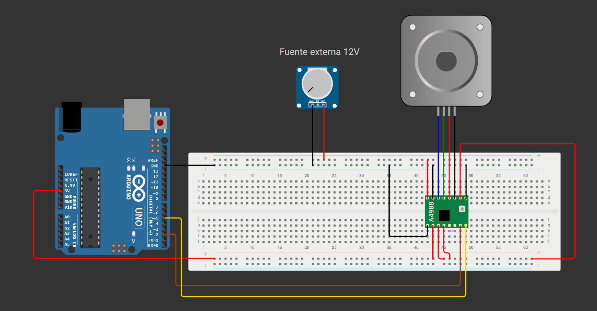

# Jeringa de Infusión Poseidon — FabLab UV
### Adaptación de Hardware Abierto | Fablab UV 🚧 *En desarrollo*

Este repositorio contiene el material técnico para la construcción de una **bomba de jeringa (syringe pump) de código abierto**, basada en el sistema **Poseidon** desarrollado por el *Pachter Lab* ([Caltech](https://github.com/pachterlab/poseidon)). El proyecto busca entregar una alternativa de bajo costo a las bombas de infusión comerciales, fabricada con piezas impresas en 3D y componentes electrónicos de fácil adquisición.

> **Nota:** Este proyecto es una **adaptación del diseño original Poseidon**. Las diferencias principales respecto a la versión del Pachter Lab se detallan en la sección [*Diferencias respecto al diseño original*](#-diferencias-respecto-al-diseño-original).

---

# Objetivo del Proyecto

Desarrollar una bomba de jeringa funcional y de bajo costo capaz de:

1. **Control de flujo de precisión:** Desplazar el émbolo de una jeringa de forma controlada mediante un motor paso a paso y un husillo.
2. **Control desde computador:** Configurar velocidad y dirección de infusión/retiro mediante comunicación Serial (USB).
3. **Fabricación local:** Construir el sistema completo con las impresoras 3D y la electrónica disponible en el FabLab UV.

---

## Vista General del Prototipo


*Vista general de la bomba armada con varillas guía de 8 mm, motor NEMA 17 y jeringa instalada.*

---

# Diferencias respecto al diseño original

Esta versión es una **adaptación simplificada** del [sistema Poseidon original](https://github.com/pachterlab/poseidon), pensada como primera iteración funcional:

| Característica | Poseidon original (Pachter Lab) | Adaptación FabLab UV |
| --- | --- | --- |
| Número de bombas | Hasta 3 bombas simultáneas | **1 bomba** |
| Driver de motor | CNC Shield + drivers DRV8825 | **1 driver A4988** (sin shield) |
| Microcontrolador | Arduino + CNC Shield | **Arduino UNO** con conexión directa al driver |
| Microstepping | 1/32 (DRV8825) | **1/16** (máximo del A4988) |
| Varillas guía | Diseño para **6 mm** | Modelo **redimensionado a 8 mm** |
| Protección del driver | Integrada en el shield | **Condensador electrolítico 100 µF** entre VMOT y GND del A4988 |

* La adaptación a **una sola bomba** responde a una primera etapa de validación; el diseño puede escalar a más canales en futuras iteraciones.
* El modelo 3D original fue diseñado para varillas de **6 mm**; en esta adaptación se **modificó el CAD para varillas de 8 mm**, ajustando soportes, carro y base.
* El firmware fue reescrito de forma **no bloqueante** (detención inmediata, pausa/reanudar funcional y reporte de progreso por Serial), manteniendo el mismo protocolo de comandos del Poseidon original.

---

# Requisitos del Sistema

## Hardware

* **Microcontrolador:** Arduino UNO
* **Driver de motor:** A4988 (1 unidad)
* **Motor:** Paso a paso NEMA 17 (200 pasos/rev)
* **Fuente de poder:** 12 V / 1.5 A o más para alimentación del motor (VMOT)
* **Mecánica:** Husillo con tuerca, varillas guía de **8 mm**, rodamientos lineales LM8UU, acoplamiento flexible
* **Jeringa:** Estándar (BD 1 mL – 60 mL según aplicación)
* **Piezas impresas en 3D:** Base, carro (sled), soporte de motor y soporte de jeringa (archivos en `HARDWARE/`)
* **Condensador:** Electrolítico 100 µF (≥ 25 V)

## Software

* **Python:** 3.10+ (64-bit)
* **VS Code + PlatformIO** (recomendado) o **Arduino IDE** 1.8+/2.x
* **Librería Arduino:** [AccelStepper](https://www.airspayce.com/mikem/arduino/AccelStepper/)
* **Sistema Operativo:** Windows 10/11 recomendado (compatible con Linux/Mac)

---

# Instalación del Entorno

## 1. Instalar Python 3.10+

Descargar desde:

https://www.python.org/downloads/

Durante la instalación marcar:

```text
☑ Add python.exe to PATH
```

## 2. Crear y activar entorno virtual

Abrir PowerShell en la carpeta del proyecto:

```bash
py -3 -m venv .venv
```

### Windows PowerShell

```bash
.venv\Scripts\activate
```

Si el entorno se activó correctamente, la terminal mostrará:

```bash
(.venv)
```

## 3. Instalar librerías

```bash
pip install pyserial PyQt5
```

**Nota:** Si se usa Arduino IDE en vez de PlatformIO, instalar la librería **AccelStepper** desde el Gestor de Librerías (*Sketch → Include Library → Manage Libraries*).

---

# Conexiones Físicas y Puesta a Punto

> **IMPORTANTE: todo el cableado se hace con la fuente de 12 V apagada.
> Nunca conectar ni desconectar el motor con la fuente energizada: puede destruir el A4988.** 

## Diagrama de conexiones



## Tabla de conexiones

### Lado lógica (A4988 → Arduino Uno)

| Pin A4988 | Va a | Nota |
|---|---|---|
| STEP | Pin D2 | Pulsos de paso |
| DIR | Pin D5 | Dirección de giro |
| ENABLE | GND del Arduino | Driver siempre habilitado |
| MS1, MS2, MS3 | 5V del Arduino | Los tres a 5V = microstepping 1/16 |
| RESET ⇄ SLEEP | Puente entre ellos | Sin este puente el driver no despierta |
| VDD | 5V del Arduino | Alimentación de lógica |
| GND (lógica) | GND del Arduino | |

### Lado potencia (A4988 → fuente y motor)

| Pin A4988 | Va a | Nota |
|---|---|---|
| VMOT | +12 V de la fuente | Ver requisitos de fuente abajo |
| GND (potencia) | − de la fuente **y** GND del Arduino | Tierra común obligatoria |
| 1A, 1B | Bobina 1 del motor | Orden libre dentro del par |
| 2A, 2B | Bobina 2 del motor | |

### Condensador (obligatorio)

| Pata | Va a |
|---|---|
| Pata larga (+) | VMOT (mismo punto donde entra el +12 V) |
| Pata corta (−, lado de la franja) | GND (mismo punto donde entra el − de la fuente) |

* Valor: **100 µF** electrolítico, 25 V o más, lo más pegado posible al driver. Protege el A4988 de los picos de voltaje del motor.
* **Ojo con la polaridad:** al revés se hincha y puede explotar.

### Identificar las bobinas del motor (4 cables)

* **Con multímetro (continuidad o Ω):** dos cables que pitan entre sí (~1–5 Ω) son una bobina → van a 1A y 1B. Los otros dos → 2A y 2B.
* **Sin multímetro:** unir dos cables entre sí y girar el eje con los dedos; si se pone duro, son la misma bobina.
* Si el motor gira al revés de lo esperado: intercambiar los dos cables de **una sola** bobina, o marcar "Invertir dirección" en la GUI.

## Requisitos de la fuente

| Parámetro | Valor |
|---|---|
| Voltaje | **12 V DC** (rango aceptable: 8–12 V) |
| Corriente | **1.5 A o más** |
| Tipo | Fuente de escritorio regulable o adaptador 12 V regulado |
| Polaridad | Verificar + y − antes de conectar a VMOT/GND |

* El **Arduino se alimenta por USB**; la fuente de 12 V es **solo para el motor** (VMOT).
* **No** alimentar el motor desde el pin 5V del Arduino.
* Tierra común obligatoria: GND del Arduino unido al − de la fuente.

## Ajuste del límite de corriente (Vref)

El potenciómetro del A4988 limita la corriente del motor. De fábrica viene alto
(~1.2 V ≈ 1.4 A) y **puede quemar el driver si no se ajusta antes de usar**.

| Vref | Corriente aprox. | Uso |
|---|---|---|
| 0.4 V | ~0.5 A | Punto de partida seguro, driver tibio |
| 0.6 V | ~0.75 A | Si falta torque |
| 0.8 V | ~1.0 A | Máximo recomendado **sin disipador** |

### Procedimiento seguro (fuente de 12 V apagada)

1. Fuente de 12 V **apagada**; solo el USB del Arduino conectado (el Vref sale de la lógica 5V).
2. Multímetro en DC 20 V: punta **roja** al tornillo metálico del potenciómetro, punta **negra** a **GND**.
3. Girar el tornillo en **micro-giros** (es muy sensible) hasta leer **0.4 V**.
4. Apagar todo, encender la fuente de 12 V y recién ahí probar movimiento.
5. Si el motor pierde pasos o no tiene fuerza, subir de a 0.1 V y re-probar.

### Señales de alerta

| Síntoma | Causa probable |
|---|---|
| Driver muy caliente / olor a quemado | Vref demasiado alto → apagar y bajar el tornillo |
| Amperaje de la fuente oscila (sube y baja) | Shutdown térmico del driver → mismo arreglo |
| Motor zumba o se traba sin girar | Bobinas cruzadas (revisar 1A/1B vs 2A/2B) |
| Eje del motor suelto con todo energizado | Falta puente RESET-SLEEP o ENABLE sin GND |
| Motor no hace nada, eje duro | No llegan pulsos STEP (revisar pin D2) o sin comunicación serial |

## Calibración

1. **Desplazamiento:** pedir 10 mm en la GUI (unidades mm/s), medir lo que avanzó el carro con calibre y ajustar el campo **"mm por vuelta"** hasta que coincidan (si avanzó más de 10 mm → subir el valor; si avanzó menos → bajarlo).
2. **Volumen:** dispensar 1 mL de agua a un recipiente graduado, comparar, y hacer el ajuste fino multiplicando el mm/vuelta por (volumen real / volumen pedido).
3. Guardar todo con **"Guardar configuración"** en la GUI (JSON).

---

# Ejecución del Proyecto

## Paso 1 — Cargar el firmware en el Arduino

**Con PlatformIO (recomendado):** abrir la carpeta `firmware/` en VS Code, conectar el Arduino UNO y presionar *Upload*. La librería AccelStepper se instala automáticamente.

**Con Arduino IDE:** renombrar `firmware/src/main.cpp` a `bomba_jeringa.ino` (eliminando la línea `#include <Arduino.h>`), instalar AccelStepper desde el Gestor de Librerías y cargar el sketch.

## Paso 2 — Identificar el puerto COM

Verificar el puerto del Arduino (ej: `COM3` en Windows) desde el Administrador de Dispositivos o desde la propia interfaz de control (botón *Actualizar*).

## Paso 3 — Ejecutar el control desde Python

```bash
python software/syringe_pump_gui.py
```

## Paso 4 — Operar la bomba

1. Seleccionar el puerto COM y presionar **Conectar**.
2. Elegir jeringa, flujo y unidades; presionar **Enviar configuración al Arduino** (el botón se pone amarillo cuando hay cambios pendientes).
3. Definir cantidad y dirección, y presionar **Iniciar**. La barra de progreso se actualiza en tiempo real.

---

# Estructura del Repositorio

```text
jeringa-de-infusion-poseidon/
│
├── HARDWARE/                  # Piezas 3D adaptadas a varillas de 8 mm
│   ├── STL/
│   └── CAD/                   # Archivos editables (Fusion 360)
├── firmware/
│   ├── platformio.ini         # Proyecto PlatformIO (Arduino UNO)
│   └── src/main.cpp           # Control del A4988 con AccelStepper (no bloqueante)
├── software/
│   └── syringe_pump_gui.py    # Interfaz gráfica de control (PyQt5)
├── docs/
│   ├── BOM.md                 # Lista de materiales y costos
│   └── diagrama_conexiones.png
└── README.md
```

---

# Flujo del Sistema

```text
PC (Python + Serial USB) → Arduino UNO → Driver A4988 → Motor NEMA 17
                                                        │
                                              Husillo + tuerca
                                                        │
                                          Desplazamiento lineal del émbolo
                                                        │
                                              Jeringa (infusión/retiro)
```

1. El usuario define velocidad y dirección desde el computador.
2. Python envía los comandos por puerto Serial al Arduino.
3. El Arduino genera las señales STEP/DIR hacia el driver A4988.
4. El driver energiza las bobinas del motor paso a paso.
5. El motor gira el husillo, que traslada el carro sobre las varillas de 8 mm.
6. El carro empuja (o tira) del émbolo de la jeringa, controlando el flujo.

---

# Tecnologías Utilizadas

* Python + PySerial + PyQt5
* Arduino UNO + AccelStepper + PlatformIO
* Driver A4988
* Motor paso a paso NEMA 17
* Impresión 3D FDM
* Diseño CAD (Fusion 360)
* Fabricación digital

---

# Aplicaciones Potenciales

* Microfluídica y laboratorios de investigación
* Dosificación controlada de líquidos
* Docencia en instrumentación biomédica
* Prototipado de equipamiento de laboratorio de bajo costo
* Automatización de experimentos

---

# Consideraciones de Seguridad

* Probar el sistema primero en **seco (dry lab)** antes de usarlo con líquidos.
* No usar con solventes orgánicos sin evaluar la compatibilidad con el plástico impreso (PLA/PETG).
* Ajustar el límite de corriente del A4988 para que el motor se detenga (*stall*) ante una obstrucción, evitando sobrepresión en la jeringa.
* Este dispositivo es un prototipo de investigación/docencia: **no es un dispositivo médico certificado**.

---

# Referencias

* **Repositorio original:** [pachterlab/poseidon](https://github.com/pachterlab/poseidon) — *poseidon system: open source syringe pumps and microscope for laboratories*
* **Documentación original:** https://pachterlab.github.io/poseidon/
* **Paper:** A. Sina Booeshaghi, Eduardo da Veiga Beltrame, Dylan Bannon, Jase Gehring and Lior Pachter, *"Principles of open source bioinstrumentation applied to the poseidon syringe pump system"*, **Scientific Reports 9**, Article 12385 (2019).
* **Diseño base de bomba:** Wijnen et al., *"Open-Source Syringe Pump Library"*, PLOS One (2014).

---

# Créditos

Adaptación desarrollada por **Maria-Ignacia Rojas**,
estudiante de pregrado de Ingeniería Civil Biomédica.

