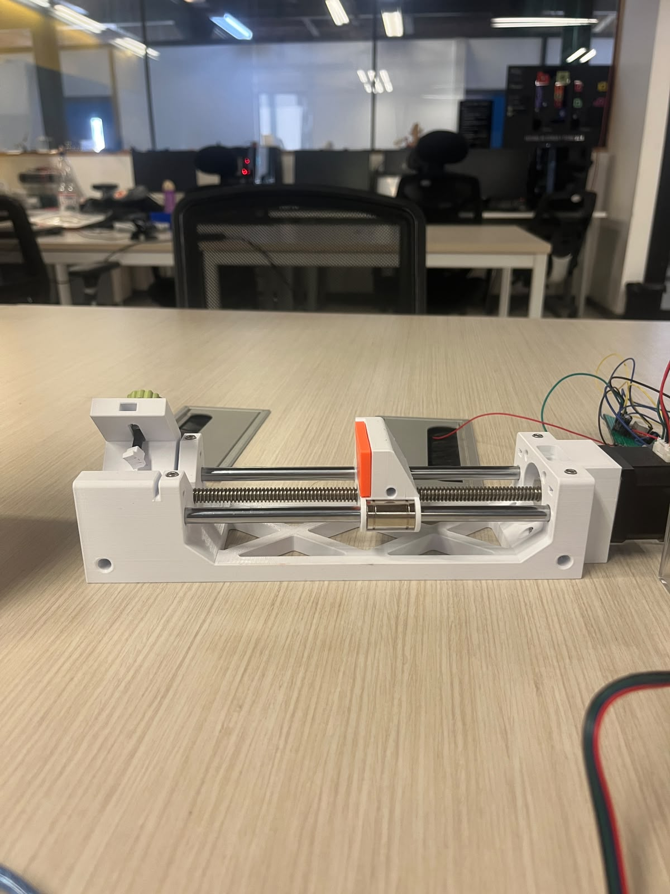
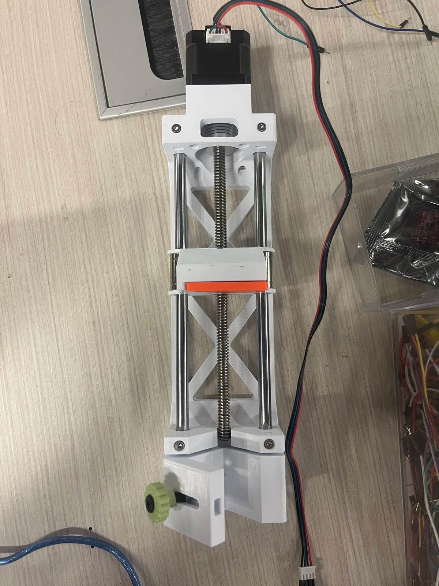
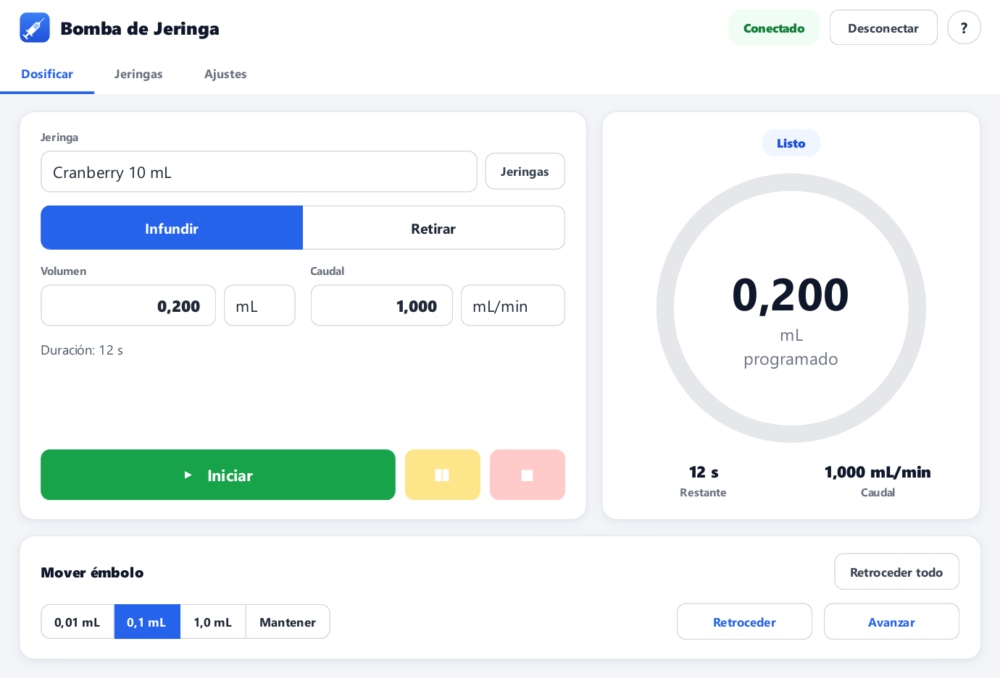
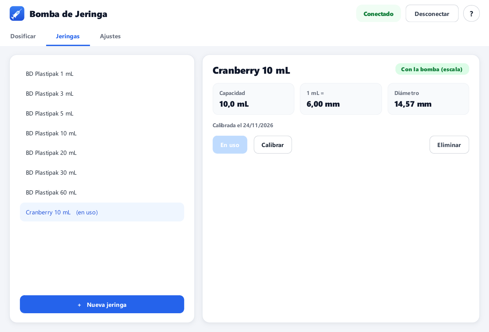
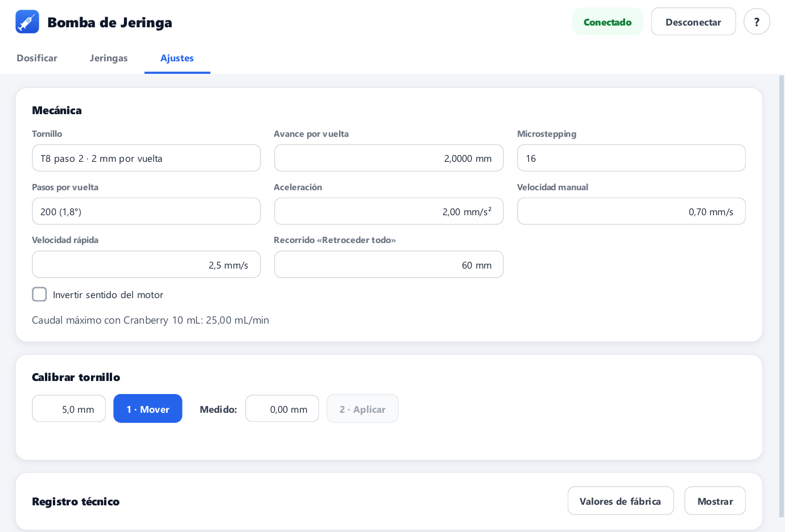
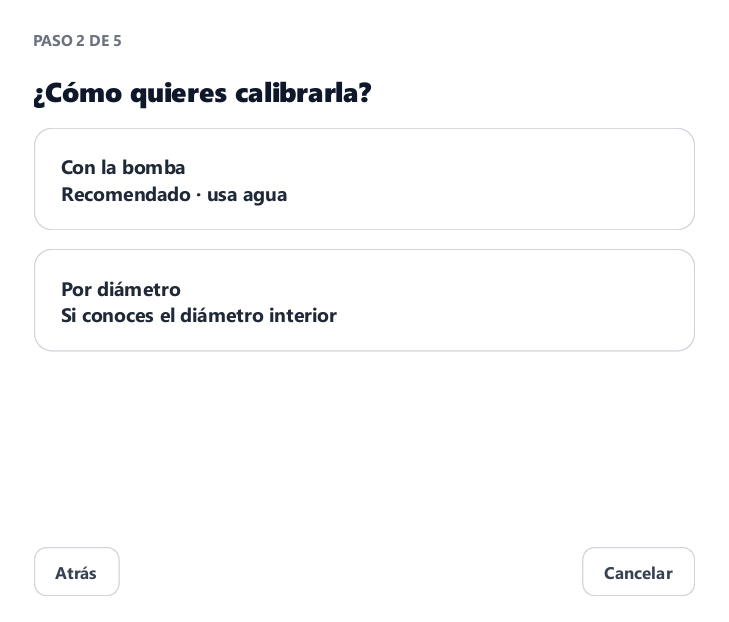
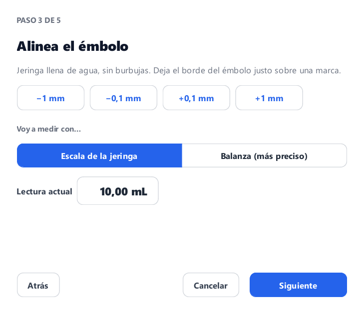
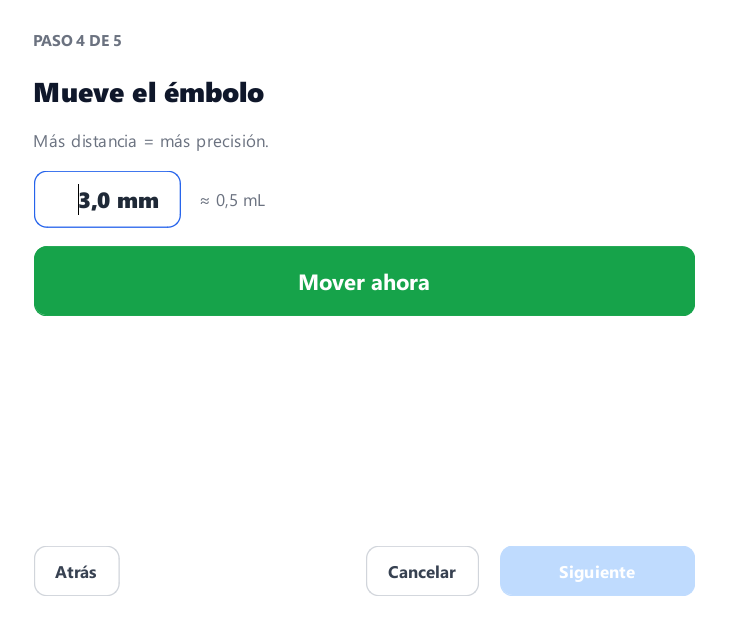
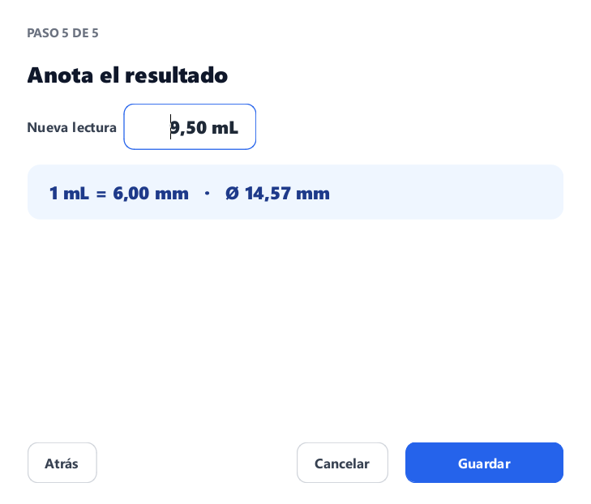
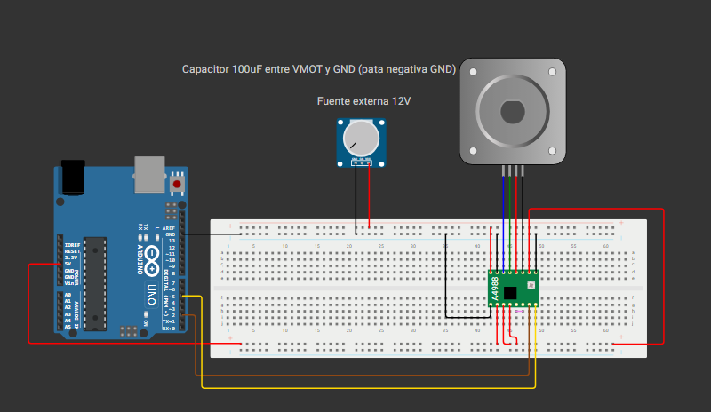

# Jeringa de Infusión Poseidon — FabLab UV
### Adaptación de Hardware Abierto | FabLab UV · v2.1

Este repositorio contiene todo lo necesario para construir y operar una **bomba de jeringa (syringe pump) de código abierto** basada en el sistema **Poseidon** del *Pachter Lab* ([Caltech](https://github.com/pachterlab/poseidon)): piezas impresas en 3D, firmware para Arduino, una aplicación de escritorio para Windows (`.exe`) y un manual de usuario en PDF.

> **Nota:** este proyecto es una **adaptación del diseño original Poseidon**. Las diferencias se detallan en [*Diferencias respecto al diseño original*](#diferencias-respecto-al-diseño-original).

---

## Novedades de la versión 2.1

* **Aplicación nueva y ejecutable (`BombaJeringa.exe`)**: no requiere instalar Python. Interfaz rediseñada en tres pestañas (*Dosificar · Jeringas · Ajustes*), con menos texto y adaptada a pantallas de alta resolución.
* **Calibración de jeringas de cualquier marca** mediante un asistente paso a paso: por graduación de la jeringa, por peso en balanza o por diámetro medido con pie de metro.
* **Calibración del tornillo** desde la app (se ordena un avance y se ingresa lo medido).
* **Botón «Retroceder todo»**: lleva el carro hacia atrás a máxima velocidad para cargar una jeringa.
* **Mover émbolo** en pasos de 0,01 / 0,1 / 1 mL o de forma continua (manteniendo presionado).
* Parámetros corregidos para el **husillo T8 de paso 2 mm** (1.600 pasos/mm ≈ 0,1 µL por paso en una jeringa de 10 mL).
* **Configuración guardada automáticamente** (jeringas calibradas y ajustes de máquina).
* **Manual de usuario en PDF** (`docs/Manual_Bomba_de_Jeringa.pdf`).

---

## Objetivo del proyecto

Desarrollar una bomba de jeringa funcional y de bajo costo capaz de:

1. **Controlar el flujo con precisión**, desplazando el émbolo con un motor paso a paso y un husillo.
2. **Operarse desde un computador** mediante una aplicación simple, pensada para usuarios sin conocimientos técnicos.
3. **Fabricarse localmente** con las impresoras 3D y la electrónica disponibles en el FabLab UV.

---

## Vista general del prototipo

| Vista lateral | Vista superior |
| :---: | :---: |
|  |  |
| *Motor NEMA 17, husillo T8, carro sobre varillas de 8 mm y jeringa.* | *Varillas guía de 8 mm, base impresa en 3D y soporte de jeringa.* |

---

## Aplicación de control

| Dosificar | Jeringas | Ajustes |
| :---: | :---: | :---: |
|  |  |  |
| *Volumen, caudal, Iniciar / Pausar / Detener y mover émbolo.* | *Jeringas guardadas y calibración de nuevas.* | *Tornillo, microstepping, velocidades y calibración.* |

**Funciones principales**

* **Dosificar:** infundir o retirar un volumen a un caudal dado (µL/min, µL/h, mL/min, mL/h), con anillo de progreso, pausa y detención inmediata.
* **Mover émbolo:** avanzar o retroceder en pasos fijos o en continuo, y **Retroceder todo** para cargar la jeringa.
* **Jeringas:** incluye jeringas BD Plastipak de 1 a 60 mL. Las jeringas de otras marcas se registran con el asistente de calibración.
* **Ajustes:** tipo de tornillo, microstepping, aceleración, velocidades, inversión de sentido y calibración del tornillo.
* **Seguridad:** bloquea caudales superiores al máximo que la mecánica puede entregar (2,5 mm/s de avance del carro).

La configuración se guarda automáticamente en `%APPDATA%\BombaJeringa\config.json`.

---

## Diferencias respecto al diseño original

| Característica | Poseidon original (Pachter Lab) | Adaptación FabLab UV |
| --- | --- | --- |
| Número de bombas | Hasta 3 simultáneas | **1 bomba** |
| Driver de motor | CNC Shield + DRV8825 | **1 driver A4988** (sin shield) |
| Microcontrolador | Arduino + CNC Shield | **Arduino UNO** conectado directo al driver |
| Microstepping | 1/32 (DRV8825) | **1/16** (máximo del A4988) |
| Varillas guía | 6 mm | **Redimensionado a 8 mm** |
| Husillo | Varilla roscada M5 | **T8 de paso 2 mm** (1 entrada) |
| Protección del driver | Integrada en el shield | **Condensador 100 µF** entre VMOT y GND |
| Firmware | Bloqueante | **No bloqueante** (detención inmediata, pausa/reanudar real, reporte de progreso) |
| Interfaz | GUI Python (3 bombas) | **App de 1 bomba rediseñada + `.exe` + manual PDF** |
| Calibración de jeringas | Lista fija de marcas | **Asistente para cualquier marca** |

* El firmware mantiene el **mismo protocolo serial** del Poseidon original (ver [Protocolo serial](#protocolo-serial)).
* El CAD original se modificó para varillas de **8 mm**, ajustando soportes, carro y base.

---

## Requisitos

### Hardware

| Componente | Detalle |
| --- | --- |
| Microcontrolador | Arduino UNO |
| Driver | A4988 (1 unidad), idealmente con disipador |
| Motor | NEMA 17, 200 pasos/vuelta |
| Husillo | **T8 paso 2 mm** (avanza 2 mm por vuelta) + tuerca + acople flexible |
| Guías | Varillas de 8 mm + rodamientos lineales LM8UU |
| Condensador | Electrolítico 100 µF, ≥ 25 V |
| Fuente | **12 V DC, 2 A o más** (ver [Alimentación](#alimentación)) |
| Piezas 3D | Base, carro, soporte de motor y de jeringa (`HARDWARE/`) |
| Jeringa | 1 – 60 mL, cualquier marca (calibrable) |

> **¿Cómo saber el paso del husillo?** Marca el eje del motor con cinta (una «bandera»), gira una vuelta completa y mide con pie de metro cuánto avanzó la tuerca. T8 de 1 entrada = 2 mm; T8 de 4 entradas = 8 mm. Este valor se configura en *Ajustes → Tornillo*.

### Software

* **Usuario final:** solo `BombaJeringa.exe` (Windows 10/11). No requiere instalar nada más.
* **Desarrollo:** Python 3.10+ (64-bit), PyQt5 y pyserial; VS Code + PlatformIO (o Arduino IDE) con la librería [AccelStepper](https://www.airspayce.com/mikem/arduino/AccelStepper/).

---

## Uso rápido (usuario final)

1. Cargar el firmware en el Arduino (solo la primera vez, ver [Firmware](#1-cargar-el-firmware)).
2. Conectar la fuente de 12 V y el cable USB al computador.
3. Abrir **`BombaJeringa.exe`**. Si Windows muestra *«Windows protegió su PC»*, presionar **Más información → Ejecutar de todas formas**.
4. Elegir el puerto y presionar **Conectar**.
5. Presionar **Retroceder todo**, cargar la jeringa y fijarla.
6. En **Dosificar**, elegir la jeringa, el volumen y el caudal, y presionar **▶ Iniciar**.

El paso a paso con imágenes está en el **[manual de usuario (PDF)](docs/Manual_Bomba_de_Jeringa.pdf)**.

---

## Calibración

### 1. Calibrar el tornillo (una vez por equipo)

1. *Ajustes → Calibrar tornillo*: ordenar un avance (por defecto 5 mm).
2. Medir con pie de metro cuánto avanzó realmente el carro.
3. Ingresar el valor medido y presionar **Aplicar**. La app corrige el avance por vuelta.

Con un T8 de paso 2 mm bien configurado, 10 mm ordenados deben dar 10 mm medidos.

### 2. Registrar una jeringa nueva (cualquier marca)

*Jeringas → Calibrar* abre un asistente:

| Método | Cómo funciona | Precisión |
| --- | --- | --- |
| **Graduación de la jeringa** | Se anota la lectura inicial, la bomba empuja una distancia conocida y se anota la lectura final. | Buena |
| **Balanza** | Se pesa el agua dispensada (1 g ≈ 1 mL). | La mejor |
| **Diámetro** | Se mide el diámetro interno con pie de metro. | Aproximada |

**Recomendaciones:**

* **Llenar la jeringa con agua y sin burbujas** antes de empezar. Si la jeringa está vacía, el émbolo empuja aire y el resultado sale mal.
* Hacer avanzar el émbolo hasta que **salga la primera gota** (alinear) y recién entonces anotar la lectura inicial.
* La app sugiere una distancia segura (~40 % de la capacidad) y **bloquea el movimiento si vaciaría la jeringa**.
* Si el resultado es poco probable, la app lo advierte y muestra el volumen esperado.
* **Verificar** dispensando un volumen conocido (por ejemplo 2 mL) antes de usarla.

*Ejemplo real:* una jeringa Cranberry de 10 mL quedó calibrada en **1 mL = 5,63 mm** (área ≈ 177,8 mm²), y una dosis de verificación de 2 mL entregó exactamente 2 mL.

| Método | Alinear | Mover | Resultado |
| :---: | :---: | :---: | :---: |
|  |  |  |  |

---

## Conexiones físicas

> **IMPORTANTE: cablear siempre con la fuente de 12 V apagada.
> Nunca conectar ni desconectar el motor con la fuente encendida: puede destruir el A4988.**

### Diagrama



### Lado lógica (A4988 → Arduino UNO)

| Pin A4988 | Va a | Nota |
| --- | --- | --- |
| STEP | D2 | Pulsos de paso |
| DIR | D5 | Dirección de giro |
| ENABLE | D8 (o GND) | Activo en LOW |
| MS1, MS2, MS3 | 5 V | Los tres a 5 V = 1/16 de paso (**obligatorio**: la app asume 1/16) |
| RESET ⇄ SLEEP | Puente entre ellos | Sin este puente el driver no despierta |
| VDD | 5 V | Alimentación de la lógica |
| GND (lógica) | GND del Arduino | |

### Lado potencia (A4988 → fuente y motor)

| Pin A4988 | Va a | Nota |
| --- | --- | --- |
| VMOT | +12 V de la fuente | |
| GND (potencia) | − de la fuente **y** GND del Arduino | **Tierra común obligatoria** |
| 1A, 1B | Bobina 1 del motor | |
| 2A, 2B | Bobina 2 del motor | |

### Condensador (obligatorio)

* **100 µF**, 25 V o más, lo más cerca posible del driver: la pata larga (+) a VMOT y la pata corta (−, lado de la franja) a GND.
* **Ojo con la polaridad:** al revés se hincha y puede explotar.

### Identificar las bobinas del motor

* **Con multímetro (Ω):** dos cables que marcan **~1–5 Ω** entre sí forman una bobina (van a 1A/1B). Los otros dos van a 2A/2B. Si un par marca infinito (OL) o el valor salta al mover el cable, hay un cable cortado o un falso contacto.
* **Sin multímetro:** unir dos cables y girar el eje con los dedos; si se pone duro, son la misma bobina.

### Sentido de giro

El firmware y la app ya vienen configurados para el cableado de este prototipo: **Infundir / Avanzar empujan el émbolo** y **Retirar / Retroceder lo tiran hacia atrás**, con la casilla *Invertir* desmarcada. Si se arma otra unidad y el motor gira al revés, marcar **Ajustes → Invertir sentido del motor** o intercambiar los dos cables de **una sola** bobina (con la fuente apagada).

---

## Alimentación

| Parámetro | Valor |
| --- | --- |
| Voltaje | **12 V DC** (el A4988 necesita al menos 8 V en VMOT) |
| Corriente | **2 A o más** (un adaptador de 12 V 4 A también sirve) |
| Conector | Jack DC con bornera: **verificar con multímetro que el + vaya a VMOT** antes de conectar |

* El **Arduino se alimenta por USB**; la fuente de 12 V es **solo para el motor**.
* **No** alimentar el motor desde el pin 5 V del Arduino.
* **2 baterías 18650 en serie (7,4 V) no alcanzan.** Alternativas portátiles: batería 3S (11,1 V) con BMS, o un *power bank* USB-C PD con un *trigger* PD a 12 V.
* En la versión actual el **computador debe permanecer conectado** durante la operación.

---

## Ajuste de corriente del driver (Vref)

El potenciómetro del A4988 limita la corriente del motor (I ≈ Vref × 1,25 con resistencias de 0,1 Ω).

| Vref | Corriente aprox. | Resultado en este prototipo |
| --- | --- | --- |
| 0,27 V | ~0,33 A | **Insuficiente**: el motor pierde pasos al empujar la jeringa |
| **0,5 V** | ~0,6 A | **Recomendado**: empuja bien y el driver queda tibio |
| 0,7 V | ~0,9 A | Más torque; requiere disipador |
| > 0,8 V | > 1 A | No recomendado sin disipador (el driver se apaga por temperatura) |

### Procedimiento seguro

1. **Fuente de 12 V apagada**; solo el USB del Arduino conectado (el Vref se mide con la lógica de 5 V).
2. Multímetro en **DC V**: punta roja sobre el potenciómetro y punta negra en GND.
3. Girar con un **destornillador de plástico o aislado** (si es metálico, cubrirlo con cinta y dejar solo la punta). **No tocar otros pines**: un corto con VMOT saca chispas y puede dañar el driver.
4. Hacer micro-giros hasta leer **~0,5 V**.
5. Apagar, conectar el motor, encender la fuente y probar.

---

## Solución de problemas

| Síntoma | Causa probable | Solución |
| --- | --- | --- |
| Motor no hace nada (ni ruido) | Falta 12 V, ENABLE en alto o falta el puente RESET-SLEEP | Revisar fuente, polaridad y puentes |
| Motor zumba, vibra o «se traba» | Bobina suelta o cruzada, o **soldadura fría** | Medir bobinas, rehacer soldaduras (deben verse brillantes y con forma de cono) |
| Funciona a ratos | Falso contacto en los cables del motor o de 12 V | Reapretar o resoldar; en protoboard, revisar que los cables queden firmes |
| Pierde pasos al empujar | Vref bajo o caudal demasiado alto | Subir el Vref a ~0,5 V o bajar el caudal |
| Funciona y luego se detiene; driver muy caliente | Vref alto, apagado térmico | Bajar el Vref y poner disipador |
| Avanza el doble, 4× o 16× de lo esperado | Paso del tornillo o microstepping mal configurado | Revisar *Ajustes*, MS1-MS3 a 5 V y calibrar el tornillo |
| La calibración de jeringa da un valor poco probable | Jeringa vacía o con aire, o lectura mal anotada | Llenar con agua, alinear hasta la primera gota y repetir |
| La app no encuentra el puerto | Cable USB, driver CH340 o puerto en uso | Reconectar, cerrar el monitor serial de PlatformIO y reabrir la app |
| Gira al revés | Cableado distinto | Marcar *Invertir sentido del motor* |

---

## Desarrollo

### 1. Cargar el firmware

**PlatformIO (recomendado):** abrir la carpeta `firmware/` en VS Code, conectar el Arduino UNO y presionar *Upload*. AccelStepper se instala sola.

**Arduino IDE:** renombrar `firmware/src/main.cpp` a `bomba_jeringa.ino`, quitar `#include <Arduino.h>`, instalar AccelStepper desde el Gestor de Librerías y cargar.

### 2. Ejecutar la app desde el código

```powershell
cd software
py -3 -m venv .venv
.venv\Scripts\activate
pip install -r requirements.txt
python syringe_pump_gui.py
```

### 3. Generar el ejecutable

```powershell
cd software
powershell -ExecutionPolicy Bypass -File .\build_exe.ps1
```

El resultado queda en `software\dist\BombaJeringa.exe` (~37 MB, un solo archivo, sin consola). Se recomienda publicarlo en **GitHub → Releases** en lugar de subirlo al repositorio.

### 4. Regenerar el manual PDF

```powershell
pip install reportlab
python docs/make_manual.py
```

---

## Protocolo serial

115.200 baudios. Comandos enviados por la app (mismo formato que el Poseidon original):

| Comando | Función |
| --- | --- |
| `<SETTING,SPEED,1,v,F,0,0,0>` | Velocidad (pasos/s) |
| `<SETTING,ACCEL,1,a,F,0,0,0>` | Aceleración (pasos/s²) |
| `<RUN,DIST,1,0,F\|B,pasos,0,0>` | Mover N pasos en sentido F o B |
| `<PAUSE,...>` / `<RESUME,...>` | Pausar / reanudar |
| `<STOP,...>` | Detener inmediatamente |

Respuestas del Arduino: `<Arduino is ready>`, `<OK>`, `<DISP1\|pasos_restantes>` (progreso) y `<DONE>`.

**Relaciones mecánicas:**

* Pasos/mm = 200 × 16 / 2 = **1.600 pasos/mm**.
* Velocidad máxima = 4.000 pasos/s = **2,5 mm/s** de avance del carro.
* Volumen (µL) = área efectiva (mm²) × desplazamiento (mm).

---

## Estructura del repositorio

```text
jeringa-de-infusion-poseidon/
│
├── firmware/
│   ├── platformio.ini             # Proyecto PlatformIO (Arduino UNO)
│   └── src/main.cpp               # Control del A4988 con AccelStepper (no bloqueante)
├── software/
│   ├── syringe_pump_gui.py        # Aplicación de control (PyQt5) v2.1
│   ├── requirements.txt
│   └── build_exe.ps1              # Genera BombaJeringa.exe con PyInstaller
├── docs/
│   ├── Manual_Bomba_de_Jeringa.pdf
│   ├── make_manual.py             # Genera el manual PDF
│   ├── img/                       # Capturas de la aplicación
└── README.md
```

---

## Flujo del sistema

```text
App (BombaJeringa.exe) ──USB Serial──► Arduino UNO ──STEP/DIR──► A4988 ──► NEMA 17
                                                                              │
                                                                   Husillo T8 (2 mm/vuelta)
                                                                              │
                                                                  Carro sobre varillas 8 mm
                                                                              │
                                                                  Émbolo de la jeringa
```

1. El usuario define el volumen y el caudal en la app.
2. La app convierte el volumen a milímetros (según el área de la jeringa) y luego a pasos (según el tornillo).
3. El Arduino genera los pulsos STEP/DIR y reporta el progreso.
4. El motor gira el husillo y el carro empuja o tira del émbolo.

---

## Mejoras futuras

* **Fin de carrera** para detener el carro automáticamente al llegar al final del recorrido.
* **Versión autónoma** sin computador (pantalla LCD con botones, o ESP32 con interfaz web).
* Soporte para más de una bomba.

---

## Consideraciones de seguridad

* Probar primero **en seco** y luego con agua antes de usar otros líquidos.
* No usar solventes orgánicos sin evaluar la compatibilidad con el plástico impreso (PLA/PETG).
* Ajustar el Vref para que el motor se detenga (*stall*) ante una obstrucción, evitando sobrepresión.
* No usar la bomba con la jeringa vacía de líquido: el carro sigue empujando hasta completar el recorrido ordenado.
* Este dispositivo es un prototipo de investigación y docencia: **no es un dispositivo médico certificado**.

---

## Referencias

* **Repositorio original:** [pachterlab/poseidon](https://github.com/pachterlab/poseidon)
* **Documentación original:** https://pachterlab.github.io/poseidon/
* **Paper:** A. Sina Booeshaghi, Eduardo da Veiga Beltrame, Dylan Bannon, Jase Gehring y Lior Pachter, *"Principles of open source bioinstrumentation applied to the poseidon syringe pump system"*, **Scientific Reports 9**, 12385 (2019).
* **Diseño base:** Wijnen et al., *"Open-Source Syringe Pump Library"*, PLOS One (2014).

---

## Créditos

Adaptación desarrollada por **Victor Contreras**, Coordinador FabLab UV, y **Maria-Ignacia Rojas**, estudiante de pregrado de Ingeniería Civil Biomédica.
